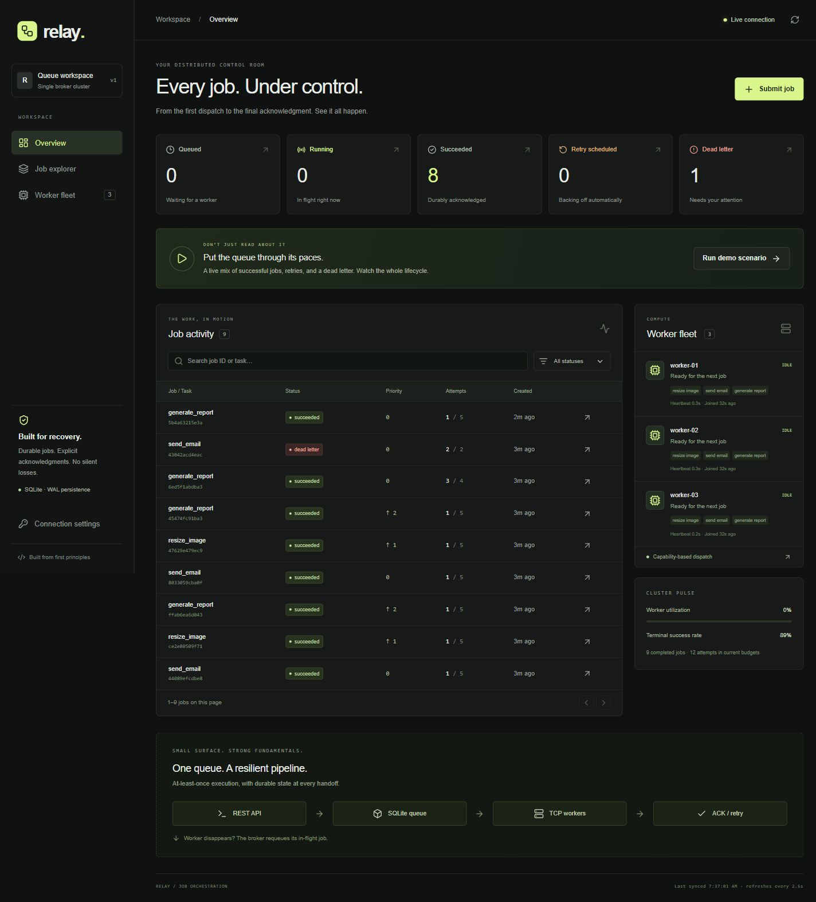

# Relay — Distributed Job Queue & Worker Orchestration

A durable queue built from first principles, with a live control room that makes its failure modes visible. Python owns the TCP broker and SQLite state machine; independent workers execute jobs; a Next.js dashboard lets you submit, inspect, and recover work.

**Designed for a local portfolio/interview demo, packaged for a single-host deployment.** No Redis, RabbitMQ, or external database required.



## Start the demo

Prerequisites: Python 3.11+ and Node.js 24. From the repository root:

```bash
python -m venv .venv
# Windows PowerShell: .venv\Scripts\Activate.ps1
# macOS/Linux: source .venv/bin/activate
pip install -r requirements-dev.txt
npm --prefix frontend ci
python scripts/demo.py
```

Open **http://127.0.0.1:3000**. The launcher starts one broker, three workers, and the dashboard, waits for readiness, and opens your browser. Ctrl+C stops its processes. Jobs survive in `var/demo.db`; logs are in `var/demo-logs/`.

Click **Run demo scenario** to enqueue eight real jobs:

- Six jobs complete normally across email, image, and report tasks.
- One report fails twice, backs off, and succeeds on its third attempt.
- One email exhausts a two-attempt budget and enters the dead-letter queue.

Inspect payloads, attempts, timestamps, results, and errors. Filter with the status cards or search. Retrying the demo dead letter resets its budget; its injected fault remains, so it fails again. Submit a clean replacement to demonstrate success after correcting the payload.

Email and image tasks are **simulations**. Reports produce real JSON artifacts. No email is sent.

### Production build locally

```bash
npm --prefix frontend run build
python scripts/demo.py --production --no-open
```

Use `--workers 5` for a larger fleet. Override occupied ports with `--port 3001 --api-port 5011 --broker-port 5556`. `--no-ui` runs only the broker and workers.

Use `--db var/another-demo.db` for a separate cluster's database. Never share one
database between live brokers. `--duration 30` stops a scripted demo after 30 seconds.

## What to demonstrate

| Capability | Evidence |
|---|---|
| Durable state machine | Claimed jobs stay in SQLite until an acknowledgment |
| Crash recovery | Kill a worker; another reclaims its job |
| Exponential retry | Scheduled retries with backoff and jitter |
| Dead-letter operations | Per-job budgets, inspection, manual requeue |
| Worker isolation | Connection-bound identities; one in-flight job per worker |
| Capability routing | Workers claim only task types they advertise |
| Observability | Dashboard, readiness, Prometheus-format metrics |
| Validated boundaries | Bounded inputs, validated frames, optional bearer auth |
| Deployment | Non-root images, persistent volumes, health checks, CI |

## Architecture

```text
 Browser → Next.js dashboard :3000
                 │ REST proxy /api/*
                 ▼
 Flask / Waitress :5010 ── shared Store ── SQLite WAL
                              ▲
                         TCP broker :5555
                              │ framed JSON
                 ┌────────────┼────────────┐
                 ▼            ▼            ▼
              Worker 1     Worker 2     Worker 3
                 └── fetch → execute → ack/fail ──┘
```

One broker owns the database connection and worker registry. Its lock serializes claims. Workers run one job at a time and heartbeat on a separate thread. Stale acknowledgments cannot complete jobs owned by another session. Timed-out sessions reconnect with fresh identities.

```text
queued → running → succeeded
           ├── task failure → failed → (backoff) → running
           ├── budget exhausted → dead-letter
           └── worker loss → queued

dead-letter → (manual retry, attempts reset) → queued
```

## Guarantees and limits

- **At-least-once execution.** Crashing after a side effect but before ACK can execute a task twice. Idempotency belongs in the integration; there is no exactly-once execution guarantee.
- **Conditional completion.** Results are accepted only for running jobs owned by the reporting session. Stale reports cannot overwrite completed results.
- **Recovery.** Socket loss, heartbeat expiry, and broker restart requeue unfinished work. Requeueing does not increment attempts; each subsequent claim does. Infrastructure reclaims contribute to the next failure's budget decision.
- **Priority.** Higher integers run first, then older jobs. High-priority traffic can starve lower priorities.
- **Single broker.** Never run multiple brokers against the same SQLite file. No leader election or broker HA. Scale workers, not brokers.
- **Runtime.** Heartbeats show session liveness, not task progress. Task execution timeouts and forced cancellation are future work.
- **Retention.** Completed jobs remain until archived/rotated. The executions statistic sums current attempt counters, which reset on manual retries.

The mock email outbox uses a SQLite unique key (message_id, defaulting to job_id) to deduplicate concurrent local deliveries. Workers must share its output volume. This is not an external SMTP guarantee. Reports use validated filenames and atomic replacement.

## API

| Method | Path | Purpose |
|---|---|---|
| POST | `/jobs` | Submit task_type, object payload, optional priority, max_attempts |
| GET | `/jobs` | Filter status, task_type, search; paginate limit, offset |
| GET | `/jobs/<id>` | Payload, status, owner, budget, result, timestamps |
| GET | `/workers` | Capabilities, current job, heartbeat age |
| GET | `/dead-letter` | Paginated dead letters |
| POST | `/dead-letter/<id>/retry` | Requeue with attempts reset |
| GET | `/stats` | State counts and live workers |
| GET | `/health` | HTTP liveness |
| GET | `/ready` | Broker/monitor and database readiness |
| GET | `/metrics` | Prometheus-format job/worker gauges |

Bodies are limited to 256 KiB. Limit: 1–200; offset: 0–1,000,000; priority: -1000–1000; max_attempts: 1–100. Job responses use job_id and UTC ISO timestamps with Z. Worker timestamps are Unix seconds. Lists include has_more.

Set **DJQ_API_KEY** in the broker environment to protect everything except health/readiness. Clients send an Authorization bearer token. Enter it in dashboard **Connection settings**; it stays in tab memory. **DJQ_API_URL** configures the dashboard upstream at runtime. The dashboard never injects a privileged server token.

TCP workers require a trusted private network: no transport encryption or worker authentication. Keep port 5555 private. For remote use, configure HTTPS, a token, and network restrictions. Compose exposes only the dashboard on loopback.

## Docker

```bash
docker compose up --build --wait --scale worker=3
docker compose logs -f broker worker
docker compose down
```

Named volumes preserve the queue and shared task outputs. Removing volumes deletes their data. Copy `.env.example` to `.env` for token/port configuration. See [operations](docs/OPERATIONS.md).

## Verification

```bash
python -m pytest tests -q
npm --prefix frontend run lint
npm --prefix frontend test
npm --prefix frontend run build
python scripts/load_test.py --jobs 100 --workers 3 --slow-jobs 2 --slow-delay 3
```

The load test creates an isolated cluster, kills a worker mid-job, submits concurrent work, and verifies every job succeeds and the victim's job was reclaimed. It uses a temporary database and output directory. Attached mode never kills external processes.

GitHub Actions runs backend tests, recovery load testing, frontend checks, and Docker Compose health checks. See [the interview walkthrough](docs/DEMO.md) and [verification notes](docs/VERIFICATION.md).

## Repository map

```text
api/server.py           REST, validation, auth, probes, metrics
common/protocol.py      Length-prefixed JSON frames
server/store.py         Durable state machine and retry scheduling
server/queue_server.py  Connection ownership, dispatch, recovery
worker/worker.py        Reconnecting sessions and execution
worker/tasks/           Registry, mock outbox, image simulation, reports
frontend/              Next.js dashboard and API proxy
scripts/demo.py        Local process supervisor
scripts/load_test.py   Crash/recovery acceptance test
compose.yaml           Single-host deployment with scalable workers
```
